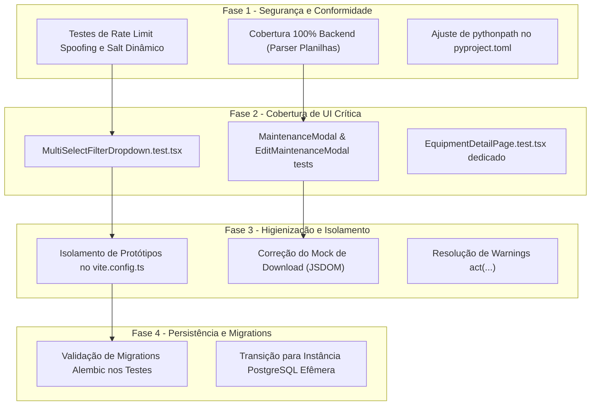

# Plano de Ação e Auditoria de QA — Gestão de Patrimônio e Suporte

**Data da Auditoria:** 14/10/2026  
**Responsável:** Engenharia de QA Sênior  
**Status do Projeto:** ATENÇÃO (Necessita de mitigação de riscos antes de novos merges)  
**Metodologia:** Spec-Driven Development (Spec-Anchored) & Pirâmide de Testes

---

## 1. Diagnóstico Executivo

A auditoria completa de testes, cobertura e conformidade com as especificações funcionais (`spec/features/`) e a [Constituição do Projeto](file:///C:/Users/70486375447/orca/workspaces/comunica-projeto/conch/spec/constituicao.md) identificou que:

- **Backend (Pytest):** 104 testes passando (~7.36s), com cobertura de **99%** (3 linhas e 1 branch descobertos no parser de planilhas). Embora funcionalmente robusto no caminho feliz, há desvios constitucionais severos: os testes rodam sobre SQLite em memória e `create_all()` em vez de PostgreSQL com migrations Alembic, além de brechas em rate limiting por spoofing de IP e salt estático em senhas.
- **Frontend (Vitest):** 57 testes passando (~25.95s), com cobertura global de apenas **62.09% de Linhas**, **71.59% de Branches** e **48.1% de Funções**. Ocorre uma falsa sensação de segurança: telas e componentes vitais (como a tela de detalhes de equipamentos e filtros múltiplos) possuem testes que apenas renderizam cabeçalhos sem exercitar gravação, edição, exclusão ou tratamento de erros de rede.
- **Código Morto & Protótipos:** Aproximadamente 1.500 linhas de protótipos em `frontend/src/prototypes/` e componentes órfãos (`AnimatedCounter.tsx`, `dashboardApi.ts`) estão inflando a base de código e distorcendo os relatórios de cobertura.

---

## 2. Matriz de Conformidade com a Constituição

| Regra Constitucional | Status Atual | Diagnóstico de QA |
| :--- | :---: | :--- |
| **Art. 2.4 — Cobertura 100% (Linhas e Branches)** | ❌ **Não Conforme** | Backend em 99% (linhas 182, 254-255 descobertas em `spreadsheet_parser.py`). Frontend em 62.09%. |
| **Art. 3.3 — Isolamento com o mesmo Banco (PostgreSQL)** | ❌ **Não Conforme** | `tests/conftest.py` utiliza `sqlite:///:memory:` mascarando comportamentos de timezone, collations e DDL do PostgreSQL. |
| **Art. 3.3 — Inicialização a partir de Migrations Alembic** | ❌ **Não Conforme** | Tabelas são criadas via `Base.metadata.create_all()`. As 4 migrations em `alembic/versions/` nunca são validadas nos testes. |
| **Art. 4.3 — Controle Transacional no Caso de Uso/Operação** | ⚠️ **Parcial** | Use cases usam `flush()`, rotas executam `commit()`. Casos de rollback composto na importação necessitam de testes de colisão. |
| **Art. 5.3 — Sincronia Spec x Testes a cada alteração** | ⚠️ **Atenção** | Funcionalidades de tela de detalhes (edição em lote, exclusão de manutenção) foram especificadas mas não exercitadas no frontend. |

---

## 3. Mapeamento de Fragilidades e Riscos Técnicos

### 🔴 Severidade Crítica [CRÍTICO]

#### [CRIT-01] Violação Constitucional de Persistência e Falta de Teste de Migrations
- **Localização:** [`tests/conftest.py`](file:///C:/Users/70486375447/orca/workspaces/comunica-projeto/conch/tests/conftest.py#L12-L20)
- **Causa Raiz:** Testes usam SQLite em memória com `Base.metadata.create_all()` e `drop_all()`.
- **Impacto / Risco:** Incompatibilidades de dialeto SQL entre SQLite e PostgreSQL passam despercebidas. Erros de sintaxe ou integridade nas migrations Alembic chegam à produção sem quebrar os testes.
- **Ação:** Configurar fixture para PostgreSQL isolado (via docker de CI ou instância descartável) e aplicar `alembic upgrade head` na suíte de testes.

#### [CRIT-02] Bypass de Rate Limiting por Spoofing de Cabeçalho `X-Forwarded-For`
- **Localização:** [`tests/test_api.py`](file:///C:/Users/70486375447/orca/workspaces/comunica-projeto/conch/tests/test_api.py#L50-L69) e [`src/api/routes.py`](file:///C:/Users/70486375447/orca/workspaces/comunica-projeto/conch/src/api/routes.py#L20-L30)
- **Causa Raiz:** O teste apenas valida requisições com proxy sem verificar segurança. `_extract_client_ip` confia cegamente no cabeçalho `X-Forwarded-For`.
- **Impacto / Risco:** Atacante pode forjar IPs arbitrários a cada tentativa, contornando a proteção contra força bruta de 10 tentativas (RN-02).
- **Ação:** Criar teste de segurança simulando IP spoofing e restringir a confiança no cabeçalho apenas a proxies reversos homologados.

#### [CRIT-03] Entropia Criptográfica Não Validada (Salt Estático em Fallback)
- **Localização:** [`tests/test_security.py`](file:///C:/Users/70486375447/orca/workspaces/comunica-projeto/conch/tests/test_security.py#L16-L26) e [`src/core/security.py`](file:///C:/Users/70486375447/orca/workspaces/comunica-projeto/conch/src/core/security.py#L24-L29)
- **Causa Raiz:** O teste não valida se senhas idênticas produzem hashes diferentes. O fallback de `hash_password` usa salt derivado da `SECRET_KEY`.
- **Impacto / Risco:** Senhas idênticas possuem o mesmo hash no fallback, expondo o banco a ataques de rainbow tables.
- **Ação:** Adicionar asserção `assert hash_password("senha") != hash_password("senha")` e utilizar `os.urandom(16)` no salt.

---

### 🟠 Severidade Alta [ALTO]

#### [ALTO-01] Cobertura Cosmética na Tela de Detalhes (`EquipmentDetailPage`)
- **Localização:** [`frontend/src/__tests__/EquipmentPage.test.tsx`](file:///C:/Users/70486375447/orca/workspaces/comunica-projeto/conch/frontend/src/__tests__/EquipmentPage.test.tsx#L121-L207)
- **Causa Raiz:** O teste apenas abre o modo de edição e clica em Cancelar.
- **Impacto / Risco:** Regressões que quebrem o salvamento em lote (RN-EQ-08), envio à API, exibição de erros e exclusão de histórico de manutenção (Cenário BDD 7) não são detectadas.
- **Ação:** Criar teste dedicado `EquipmentDetailPage.test.tsx` cobrindo o fluxo completo de edição, salvamento, persistência na API e exclusão de registros.

#### [ALTO-02] Ausência de Testes para o Componente de Filtro Múltiplo (`MultiSelectFilterDropdown`)
- **Localização:** [`frontend/src/components/MultiSelectFilterDropdown.tsx`](file:///C:/Users/70486375447/orca/workspaces/comunica-projeto/conch/frontend/src/components/MultiSelectFilterDropdown.tsx)
- **Causa Raiz:** Cobertura de apenas 38%, sem nenhum arquivo de teste correspondente.
- **Impacto / Risco:** Quebra nas regras RN-EQ-03, RN-EQ-04 e Cenários BDD 1 a 3 (busca interna, checkboxes múltiplos, botão "Desmarcar tudo" e fechamento ao clicar fora).
- **Ação:** Criar `MultiSelectFilterDropdown.test.tsx` com cobertura unitária exaustiva.

#### [ALTO-03] Ausência de Testes para Modais de Manutenção (`MaintenanceModal` e `EditMaintenanceModal`)
- **Localização:** [`frontend/src/components/MaintenanceModal.tsx`](file:///C:/Users/70486375447/orca/workspaces/comunica-projeto/conch/frontend/src/components/MaintenanceModal.tsx) e [`frontend/src/components/EditMaintenanceModal.tsx`](file:///C:/Users/70486375447/orca/workspaces/comunica-projeto/conch/frontend/src/components/EditMaintenanceModal.tsx)
- **Causa Raiz:** Cobertura de funções em 20%, sem testes disparando formulários e validações.
- **Impacto / Risco:** Impossibilidade de o técnico cadastrar ou editar manutenções em caso de falha de validação ou payload.
- **Ação:** Criar `MaintenanceModal.test.tsx` e `EditMaintenanceModal.test.tsx` testando envio, loading, validação obrigatória e erro de API.

---

### 🟡 Severidade Média [MÉDIO]

#### [MED-01] Asserção Inócua no Teste de Exportação Excel
- **Localização:** [`tests/test_equipment_api.py`](file:///C:/Users/70486375447/orca/workspaces/comunica-projeto/conch/tests/test_equipment_api.py#L369-L416)
- **Causa Raiz:** O teste apenas valida `assert len(resp.content) > 0`.
- **Ação:** Inspecionar os bytes do arquivo `.xlsx` via `openpyxl.load_workbook()` para validar a aba "Patrimônio", as 13 colunas e a contagem correta de linhas filtradas.

#### [MED-02] Erro Assíncrono no JSDOM Durante Teste de Download
- **Localização:** [`frontend/src/__tests__/EquipmentPage.test.tsx`](file:///C:/Users/70486375447/orca/workspaces/comunica-projeto/conch/frontend/src/__tests__/EquipmentPage.test.tsx#L209-L259)
- **Causa Raiz:** Chamada de `a.click()` em link `blob:` dispara erro de navegação não implementada no JSDOM.
- **Ação:** Mockar `HTMLAnchorElement.prototype.click = vi.fn()` nos testes de download.

#### [MED-03] Faltam Testes de Casos de Borda no Parser de Planilhas (100% Backend)
- **Localização:** [`src/infrastructure/spreadsheet_parser.py`](file:///C:/Users/70486375447/orca/workspaces/comunica-projeto/conch/src/infrastructure/spreadsheet_parser.py#L182,L254-L255)
- **Causa Raiz:** Linhas vazias no Excel e falha do `csv.Sniffer` não testadas.
- **Ação:** Adicionar cenários específicos em `tests/test_spreadsheet_parser.py` para restaurar a cobertura de 100%.

#### [MED-04] Warnings de `act(...)` no Frontend
- **Localização:** [`frontend/src/__tests__/ImportPage.test.tsx`](file:///C:/Users/70486375447/orca/workspaces/comunica-projeto/conch/frontend/src/__tests__/ImportPage.test.tsx) e `DashboardPage.test.tsx`
- **Causa Raiz:** Atualizações de estado do `AuthProvider` assíncronas não aguardadas antes da desmontagem.
- **Ação:** Ajustar ciclos de vida assíncronos com `await waitFor(() => ...)`.

---

### 🟢 Severidade Baixa [BAIXO]

#### [BAIX-01] Protótipos e Código Morto Poluindo Métricas de Cobertura
- **Localização:** `frontend/src/prototypes/`, `AnimatedCounter.tsx`, `dashboardApi.ts`
- **Ação:** Excluir da cobertura no `vite.config.ts` ou remover definitivamente se obsoletos.

#### [BAIX-02] Falta de `pythonpath = ["."]` no `pyproject.toml`
- **Localização:** [`pyproject.toml`](file:///C:/Users/70486375447/orca/workspaces/comunica-projeto/conch/pyproject.toml)
- **Ação:** Adicionar `pythonpath = ["."]` em `[tool.pytest.ini_options]` para permitir execução direta do pytest.

---

## 4. Plano de Execução Priorizado (Roadmap de QA)

### Checklist Detalhado das Ações

#### 🔹 Fase 1: Segurança e Conformidade Constitucional Imediata
- [ ] **[Backend]** Criar caso de teste em `tests/test_spreadsheet_parser.py` para planilha com linhas em branco intercaladas (linha 182).
- [ ] **[Backend]** Criar caso de teste em `tests/test_spreadsheet_parser.py` forçando exceção no `csv.Sniffer` para exercitar o fallback manual (linhas 254-255).
- [ ] **[Backend]** Adicionar asserção em `tests/test_security.py` exigindo salts dinâmicos diferentes para a mesma senha.
- [ ] **[Backend]** Adicionar teste de penetração em `tests/test_rate_limit.py` validando bloqueio contra tentativas com IP spoofed via `X-Forwarded-For`.
- [ ] **[Config]** Adicionar `pythonpath = ["."]` em `[tool.pytest.ini_options]` no `pyproject.toml`.

#### 🔹 Fase 2: Blindagem de Telas e Modais do Frontend
- [ ] **[Frontend]** Implementar `frontend/src/__tests__/MultiSelectFilterDropdown.test.tsx`:
  - Abertura/fechamento ao clicar.
  - Filtro em tempo real via input de busca interna.
  - Seleção e desmarcação múltipla via checkboxes (disparando `onChange`).
  - Ação do botão "Desmarcar tudo".
  - Fechamento ao clicar fora do componente.
- [ ] **[Frontend]** Implementar `frontend/src/__tests__/MaintenanceModal.test.tsx`:
  - Validação de obrigatoriedade de descrição.
  - Disparo da chamada à API `equipmentApi.recordMaintenance`.
  - Tratamento de loading e mensagens de erro HTTP 400/500.
- [ ] **[Frontend]** Implementar `frontend/src/__tests__/EditMaintenanceModal.test.tsx`:
  - Carregamento inicial com os dados da manutenção existente.
  - Submissão de alterações para `equipmentApi.updateMaintenance`.
  - Tratamento de erro da API.
- [ ] **[Frontend]** Implementar `frontend/src/__tests__/EquipmentDetailPage.test.tsx`:
  - Modo de edição em lote (alterar múltiplos campos e salvar com sucesso).
  - Verificação de exibição de erro ao falhar atualização no backend.
  - Abertura dos modais de movimentação e manutenção a partir dos botões da tela.
  - Fluxo de exclusão de manutenção com confirmação (Cenário BDD 7).
  - Alternância do mascaramento da Chave Windows (RN-EQ-14).

#### 🔹 Fase 3: Higienização de Métricas e Estabilização de Testes
- [ ] **[Frontend]** Atualizar `coverage.exclude` no `vite.config.ts` para excluir `src/prototypes/**`, `AnimatedCounter.tsx` e `dashboardApi.ts`.
- [ ] **[Frontend]** Ajustar o mock de `HTMLAnchorElement.prototype.click` em `EquipmentPage.test.tsx` para eliminar o erro `Not implemented: navigation`.
- [ ] **[Frontend]** Envolver atualizações assíncronas do `AuthProvider` em `await waitFor(() => ...)` eliminando os alertas de `act(...)`.

#### 🔹 Fase 4: Persistência Real e Migrations Alembic
- [ ] **[Backend]** Adicionar teste de migração verificando que `alembic upgrade head` executa sem erros em banco limpo.
- [ ] **[Backend]** Configurar ambiente de teste no GitHub Actions para rodar a suíte contra PostgreSQL descartável (Docker service container), assegurando paridade com o ambiente produtivo conforme o Artigo 3 da Constituição.

---

## 5. Critérios de Aceite (Quality Gates) para o Release

1. **Backend:** 100% de cobertura em linhas e branches no Pytest (`--cov-fail-under=100`).
2. **Frontend:** Cobertura de linhas superior a 85% em componentes e páginas de produção (excluindo protótipos).
3. **Zero Warnings:** Eliminação de erros assíncronos não tratados no JSDOM e warnings de `act(...)`.
4. **Alinhamento SDD:** Todos os cenários BDD das especificações em `spec/features/` mapeados com testes automatizados correspondentes no mesmo repositório.
